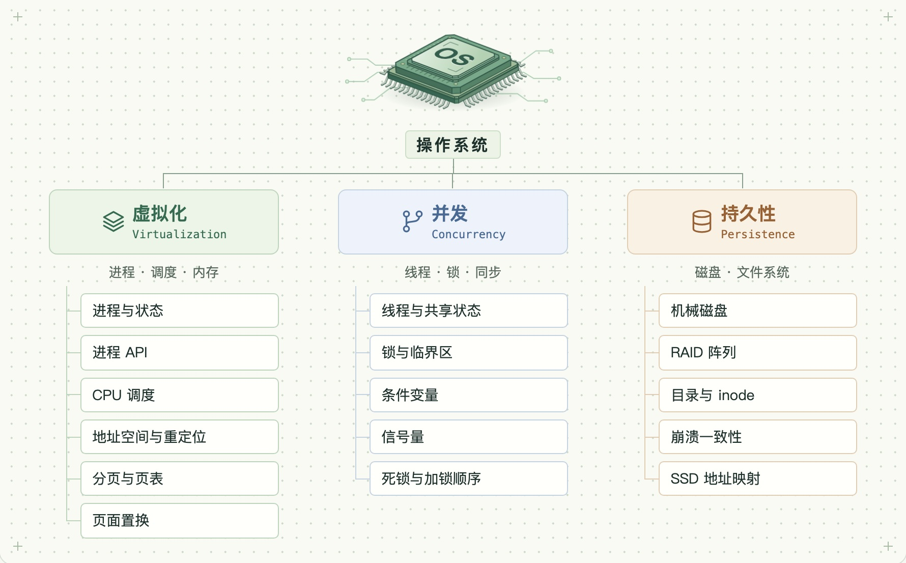

# OSTEP

操作系统导论学习笔记

用浏览器打开[操作系统学习地图](index.html)，从虚拟化、并发或持久性进入对应的教材章节、预测题和仓库练习。页面可离线使用，复习进度保存在当前浏览器中。

[章节笔记](handout.md) · [中文教材](操作系统导论-OSTEP.pdf) · [示例代码](code/README.md) · [模拟练习](homework/README.md) · [课程项目](projects/README.md)
